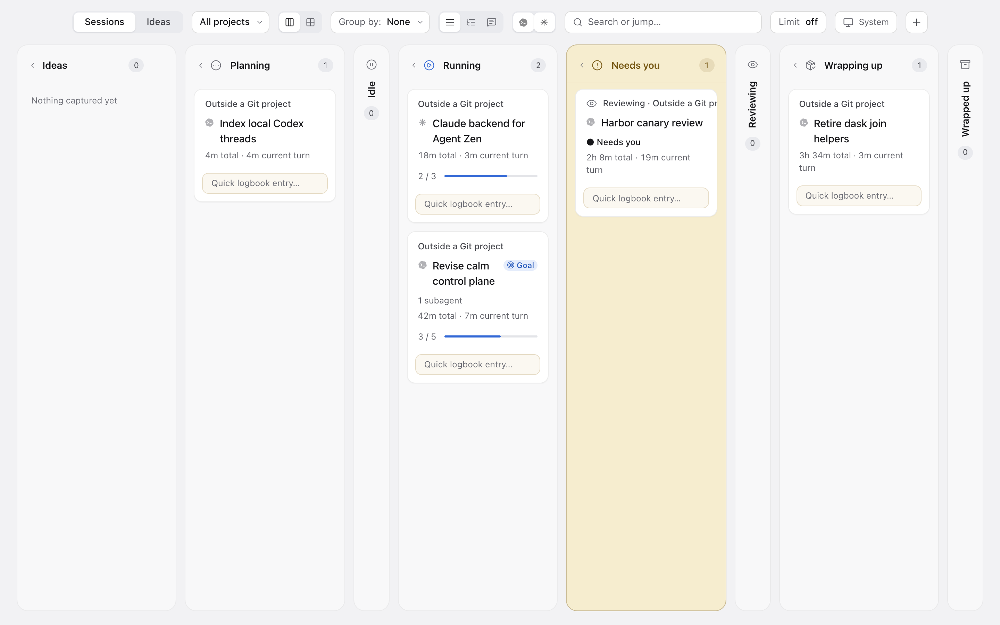

# Agent Zen

[](https://github.com/lucharo/agent-zen/releases/latest)
[](#install)
[](LICENSE)

A calm, local view of the Codex and Claude Code sessions already running on your Mac.

It answers a few practical questions: what is active, what project does it belong to, what is the agent doing now, and which sessions actually need your attention?

It exists because pen and paper is surprisingly good at managing agent work. A small page has edges. It makes you choose. The trouble starts after launching the sessions: the paper no longer knows which ones are still alive, which plan changed, or where the worktree went. Agent Zen keeps the useful constraint and adds back that missing visibility.

This is not a throughput dashboard. It is an active shelf for choosing what to care about.



*The board with the app's built-in sample sessions.*

## What it reads, and where that stays

Agent Zen runs on your Mac and reads what your agents already write there:

- **Codex:** running `codex` processes, `~/.codex/state_5.sqlite` and the rollout JSONL files those sessions have open.
- **Claude Code:** the live registry under `~/.claude/sessions`, the matching project transcripts and task files.

Those files hold your prompts and agent output, so treat the app like any other tool with read access to them. The service binds only to loopback, and Agent Zen itself uploads nothing: it has no account, no telemetry and no remote server. A Codex session you launch from it talks to your model provider as usual. Its own settings live in `~/.agent-zen/`; Ideas and Logbook notes stay in browser storage. It installs no hooks and edits no agent settings.

## What it does

- Shows one card per root agent session, with Codex child agents contained inside their parent.
- Reads native Codex goals, plans and turns plus Claude Code tasks and session state without asking either agent to maintain another ledger.
- Projects sessions into Planning, Idle, Running, Needs you, Reviewing, Wrapping up and Wrapped up. Needs you wins the visible lane without erasing the workflow phase; collapsed lanes can remain as rails or be hidden.
- Offers a compact grid when the Kanban columns are too much.
- Keeps Ideas as a human-owned space before planning, plus a private Logbook attached to each session. Cards can show those comments without mixing them into agent state.
- Leaves the session board read-only. Agent Zen observes both agents; supported control remains limited to Codex sessions launched by Agent Zen.

Finished or archived sessions leave the active board. There is deliberately no Done column competing for attention.

Cards are grouped and filtered by project. Agent Zen discovers projects from Git checkouts under `~/Projects/github.com`, two levels deep. A session in a GitHub repository elsewhere shows its `owner/name` until you add that repository's parent folder to `projectRoots` in `~/.agent-zen/settings.json`; see the [FAQ](docs/faq/README.md#why-is-my-repository-or-worktree-missing).

## Install

**The Mac app.** The notarised app installs from this repository's Homebrew tap. Homebrew 6 and later ask you to trust a third-party tap first. It needs macOS Sonoma or newer, and Codex or Claude Code already in use. It also needs [Bun](https://bun.sh), which runs its small bridge; the cask installs Bun for you.

```sh
brew tap lucharo/agent-zen https://github.com/lucharo/agent-zen.git
brew trust --tap lucharo/agent-zen
brew install --cask agent-zen
```

Open Agent Zen from Applications. It starts in the menu bar without opening a window: choose **Open Agent Zen** from its menu-bar icon, or open the app again, to see the board. Your running Claude Code and Codex sessions appear within a few seconds. The DMG and PKG are also attached to each [release](https://github.com/lucharo/agent-zen/releases/latest).

The app serves its window from `http://127.0.0.1:5275`. When a CLI daemon speaking the same bridge protocol runs on 5274, the app reads through it; otherwise the app starts its own bridge. Ideas and Logbook notes are browser storage, so the app window and a browser tab on 5274 keep separate copies.

**The CLI and daemon.** With [Bun](https://bun.sh) installed, a checkout installs a CLI and a user LaunchAgent that serves the same app on `http://localhost:5274/`, keeps it alive, and starts it again at login.

```sh
git clone https://github.com/lucharo/agent-zen.git
cd agent-zen
bun install
bun run install:cli
agent-zen daemon start
agent-zen open
```

The installer puts the CLI in `~/.local/bin/agent-zen`. If that directory is not on your `PATH`, call it by its full path. `main` can carry an unreleased version number; check out a [release tag](https://github.com/lucharo/agent-zen/tags) to install exactly what the app ships.

```sh
agent-zen daemon status
agent-zen daemon status --json
agent-zen sessions
agent-zen sessions --json
agent-zen explain <session-id-or-title-prefix>
agent-zen daemon logs --follow
agent-zen daemon restart
agent-zen daemon stop
```

`daemon start` and `daemon stop` are idempotent. Start installs and enables `io.lucharo.agent-zen`; stop unloads and disables it. The service binds only to loopback. Its LaunchAgent lives at `~/Library/LaunchAgents/io.lucharo.agent-zen.plist`, with logs and settings under `~/.agent-zen/`.

`sessions` and `explain` read the same classified daemon snapshot as the board. Both include the current explicit goal, when one exists. `explain` also reports the stable stage reason, so a CLI check and the visible column cannot silently use different classifiers.

After updating the repository, run `bun run install:cli` again followed by `agent-zen daemon restart`. Do the same after `brew upgrade --cask agent-zen` if you also run the daemon. Otherwise the app, finding a different bridge protocol on 5274, starts its own bridge and a second Codex app-server, and `agent-zen sessions` keeps reporting the old daemon.

## Where the idea came from

The starting point was not another project-management system. It was the experience of running many agent sessions, opening another one whenever a thought appeared, and gradually losing the shape of the work. A handwritten list fixed the attention problem but could not follow the live sessions. Agent Zen grew out of that gap.

Several tools informed it:

- [Kenn Forge](https://github.com/kenn-io/forge), previously called Middleman, showed how a local daemon can discover repositories, worktrees and ongoing work. Agent Zen borrows that local-first operational shape, not Forge's much broader interface.
- [Vibe Kanban](https://github.com/BloopAI/vibe-kanban) showed the appeal of keeping agent sessions visible and controllable from one place. Agent Zen is intentionally quieter and optimises for bounded attention rather than maximum parallel throughput.
- [agentsview](https://github.com/wesm/agentsview) demonstrated how useful the agent's own local session records can be when gathered into a dependable browser. Agent Zen uses the same general principle but focuses on the small set of sessions that are active now.
- [RoboRev](https://github.com/roborev-dev/roborev) and the Kenn/Wes CLI family influenced the familiar `daemon start|status|restart|stop` contract.
- [Kanban Code](https://github.com/langwatch/kanban-code), [Things 3](https://culturedcode.com/things/) and a local task-manager experiment contributed smaller ideas: native-feeling session controls, global Quick Entry-style keyboard capture, project assignment and centred detail sheets.

These are influences, not dependencies or claims of feature parity. The product boundary came from the paper workflow: unlimited capture, a deliberately small active horizon, and no obligation to react to every session just because it is visible.

## How the agent connections work

The loopback Bun service merges two isolated backends:

1. **Codex:** observes active processes, `~/.codex/state_5.sqlite`, and matching rollout JSONL files, while one bundled `codex app-server --stdio` child controls sessions launched through this Agent Zen process.
2. **Claude Code:** reads the stock CLI's live registry under `~/.claude/sessions`, matching project transcripts, and task files. It does not install hooks, edit settings, wrap the CLI, or change how Claude starts.

ACP and hooks are not required. Existing Codex sessions and every Claude session remain read-only. Goals and plans are optional: a successful Codex goal-tool result becomes the session's explicit goal, while Claude task files project into the same current-plan shape. See [ADR-0002](docs/adr/0002-native-codex-connection.md) for Codex ownership and [ADR-0009](docs/adr/0009-claude-code-observer-and-agent-backends.md) for the multi-agent boundary.

The browser refreshes the snapshot every second. UI preferences, registered projects and the optional focus limit live in `~/.agent-zen/settings.json`. Ideas and the human-only Logbook remain local browser data.

The agent toggles change only what is drawn. Planning and Running root sessions from both backends still count toward the focus limit, so hiding Claude cannot make a full board appear to have a free Codex launch slot.

The Sessions board follows the accepted state order, collapses empty lanes automatically, and lets any populated lane be folded. In Grid view, grouping by state omits empty groups.

## Native macOS shell

The repository also contains a small AppKit and WKWebView shell. It launches quietly in the menu bar without opening a window or taking over the active desktop. The menu shows separate Running, Reviewing and Wrapping up counts, while its three-bar icon gives a compact live view of those stages.

`Option-Space` opens only Quick Capture from anywhere. Change it from the menu-bar item's **Quick Capture Shortcut** submenu; `Control-Space`, `Option-Command-Space` and Off are included. `Command-N` opens the same capture surface while Agent Zen is active, and `Command-,` opens Settings.

```sh
bun run build:macos
```

`bun run release:macos` produces the hardened, notarised Developer ID build as a stapled PKG and DMG. See [docs/macos-release.md](docs/macos-release.md) and [ADR-0007](docs/adr/0007-native-shell-and-distribution.md).

## Development

```sh
bun run bridge       # source bridge on http://127.0.0.1:5274
bun run dev          # Vite on http://127.0.0.1:5273
bun run check        # types, unit/server/CLI tests, production build
bun run test:daemon  # installed launchd start/stop/restart lifecycle
bun run test:memory  # separate bridge and bridge+Codex peak-memory gates
bun run test:native  # native bridge protocol and shortcut contract
bun run test:a11y    # Playwright and axe
```

Stop the installed daemon before running the source bridge on the same port.

The accepted product decisions are indexed in [docs/adr](docs/adr/README.md). The [FAQ](docs/faq/README.md) explains stages, refresh, storage, daemon persistence, native requests, worktree identity and focus limits. The [QA index](qa/README.md) records browser evidence rather than treating a successful build as proof of the UI.

## Licence

[MIT](LICENSE).
