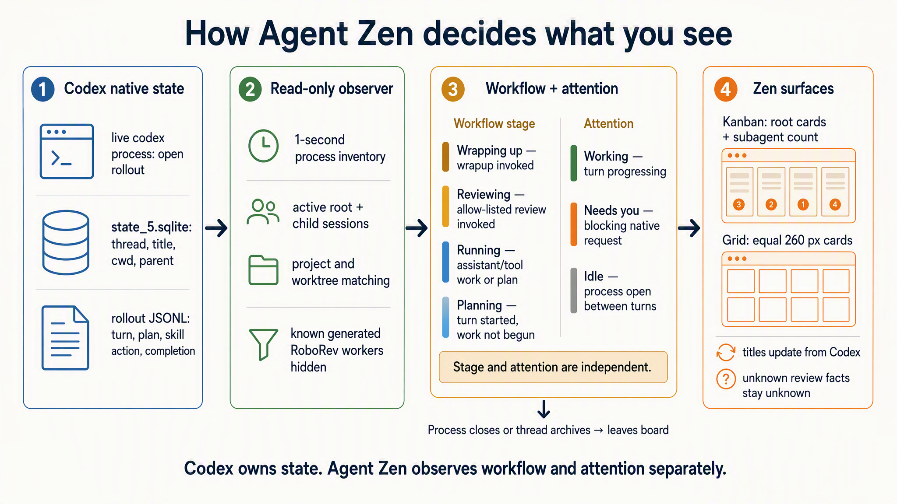
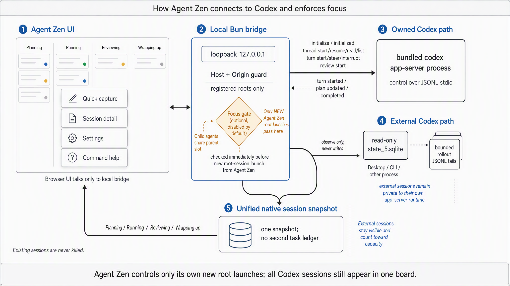
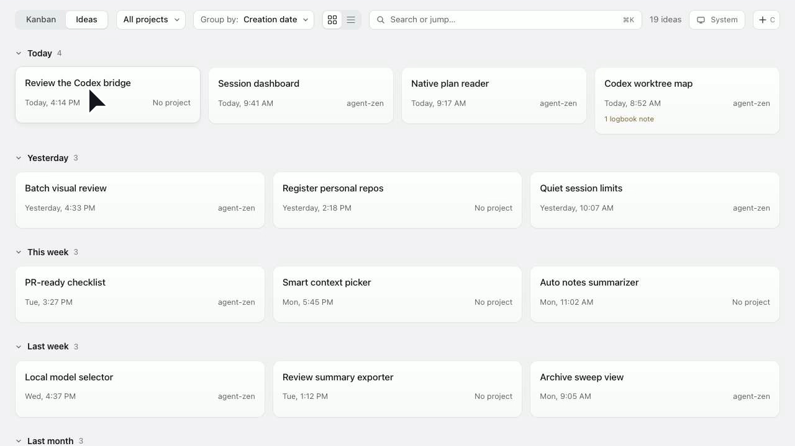

# Agent Zen FAQ

Agent Zen is a local control plane for Codex and Claude Code: each agent owns its session state; Agent Zen reads it, groups it, and adds a separate human Ideas and Logbook layer.

_Conceptual visual generated from the verified contracts below. The code and tests remain authoritative for exact predicates._

## How does Agent Zen connect to Codex?

**Short answer:** The local bridge combines supported Codex App Server control for sessions it launches with read-only process, SQLite, and rollout observation for sessions running elsewhere. ACP and hooks are not required.

On macOS, the observer asks `lsof` which rollout JSONL files are currently held open by live `codex` processes. Those thread ids define the active shelf. It then reads metadata from `~/.codex/state_5.sqlite` and lifecycle, message, plan, and completion records from the matching rollout files. It never writes to those stores. Agent Zen-owned launches use a bundled `codex app-server --stdio` child; externally launched sessions remain visible but read-only. A new thread is registered as owned before its first turn begins so early plan, lifecycle, and approval events are retained. If that first turn fails, Agent Zen best-effort archives the newly created native thread instead of leaving an orphan. Ownership is connection-scoped: restarting the Agent Zen daemon preserves visibility but turns previously owned sessions into external, observation-only sessions.

### Sources

- [ADR-0002](../adr/0002-native-codex-connection.md) — accepted integration boundary and rejected alternatives.
- [Codex observer](https://github.com/lucharo/agent-zen/blob/main/server/codex/stateObserver.ts) — SQLite and rollout observation.
- [Bridge service](https://github.com/lucharo/agent-zen/blob/main/server/bridgeService.ts) — observation and App Server control composition.

_Created: 2026-08-06 · Updated: 2026-08-10 · Verified: 2026-08-10 · Scope/version: Codex CLI 0.147.0 local stores_

## How does Agent Zen connect to Claude Code?

**Short answer:** It reads the stock Claude Code CLI's live session registry, transcripts and task files. It does not install hooks, alter settings, wrap the command, or require ACP.

`~/.claude/sessions/<pid>.json` supplies live membership, cwd, version, activity and waiting state. Agent Zen verifies the pid is alive, then locates the matching JSONL transcript under `~/.claude/projects` for titles, prompts, model, branch and workflow hints. A matching directory under `~/.claude/tasks` becomes the current plan. Every Claude session is read-only; when it needs input, Agent Zen points back to the terminal where it is running.

These files are an observed Claude Code 2.1.259 contract rather than a public control API. Parsing is isolated behind the Claude backend so a format change can make Claude unavailable without hiding Codex sessions.

### Sources

- [ADR-0009](../adr/0009-claude-code-observer-and-agent-backends.md) — accepted evidence and product boundary.
- [Claude backend](https://github.com/lucharo/agent-zen/blob/main/server/claude/claudeBackend.ts) — read-only session composition.
- [Registry reader](https://github.com/lucharo/agent-zen/blob/main/server/claude/registry.ts) — live process membership and status.
- [Claude regressions](https://github.com/lucharo/agent-zen/blob/main/server/claude/claudeBackend.test.ts) — registry, transcript, task and composition coverage.

_Created: 2026-09-04 · Updated: 2026-09-04 · Verified: 2026-09-04 · Scope/version: Claude Code 2.1.259 local stores_

## Which native Codex requests can Agent Zen answer?

**Short answer:** For a session launched by the current Agent Zen bridge, the centred detail dialog can answer native user questions, command approvals, file-change approvals, and additional permission requests. External sessions remain observation-only.

User questions preserve Codex's question text and selectable options. Command and file approvals expose only decisions advertised by the request, including approve once, approve for session, decline, and cancel where supported. Permission requests grant the exact requested network or filesystem profile for either the current turn or session. Agent Zen does not silently broaden a request.

Unknown App Server request types remain visibly blocked and keep **Interrupt** available, but must be answered in the native Codex client. Every response is sent as a JSON-RPC response on the same App Server connection that created the session.

### Sources

- [App Server client](https://github.com/lucharo/agent-zen/blob/main/server/codex/appServerClient.ts) — JSON-RPC request and response transport.
- [Request mapping](https://github.com/lucharo/agent-zen/blob/main/server/bridgeService.ts) — supported native requests, exact permission profile, and connection ownership.
- [Centred request UI](https://github.com/lucharo/agent-zen/blob/main/src/components/DetailSheet.tsx) — question, approval, permission, fallback, and interrupt surfaces.
- [Request regressions](https://github.com/lucharo/agent-zen/blob/main/server/bridgeService.test.ts) — native response payloads and permission scope.

_Created: 2026-08-10 · Updated: 2026-08-10 · Verified: 2026-08-10 · Scope/version: Codex CLI 0.147.0 App Server_

## What survives an Agent Zen daemon restart?

**Short answer:** The daemon, settings, registered projects, Ideas, Logbook notes, and observed Codex and Claude sessions return. Control ownership of previously launched Codex sessions does not.

`agent-zen daemon start` validates installed assets, repairs a missing LaunchAgent plist or disabled login override, and waits up to 20 seconds for the authenticated health endpoint. That window deliberately exceeds Codex App Server's 15-second initialization timeout. Preferences, focus policy, project roots, and registered project directories remain in `~/.agent-zen/settings.json`. Ideas, Logbook notes, and their project cache remain in browser storage.

The App Server connection and its owned-thread map are intentionally in memory. After restart, the same Codex sessions are rediscovered through their live process, SQLite, and rollout records, but they appear as external read-only sessions. Agent Zen will not claim control of a thread created by an earlier process.

### Sources

- [Daemon CLI](https://github.com/lucharo/agent-zen/blob/main/cli/index.ts) — persistence repair and authenticated health checks.
- [Daemon contract tests](https://github.com/lucharo/agent-zen/blob/main/cli/daemon.test.ts) — missing-plist and disabled-override regression.
- [Bridge ownership](https://github.com/lucharo/agent-zen/blob/main/server/bridgeService.ts) — connection-generation ownership map.
- [Ownership regression](https://github.com/lucharo/agent-zen/blob/main/server/bridgeService.test.ts) — reconnect turns an owned session into external observation.

_Created: 2026-08-10 · Updated: 2026-09-04 · Verified: 2026-09-04_

## How does Agent Zen know whether a session has a goal?

**Short answer:** It reads the successful Codex goal-tool result. It does not infer a goal from the prompt, title, plan, or a mention of `create_goal` in diagnostic text.

The rollout parser matches a real `create_goal`, `update_goal`, or `get_goal` call to its result by call id, then keeps the objective and status in the canonical session snapshot. The observer can recover that pair after it falls outside the normal rollout tail. Cards show a compact Goal badge; the detail view and `agent-zen sessions --json` or `agent-zen explain ... --json` show the objective and status.

### Sources

- [Rollout parser](https://github.com/lucharo/agent-zen/blob/main/server/codex/rollout.ts) — matched goal call and result extraction.
- [Codex observer](https://github.com/lucharo/agent-zen/blob/main/server/codex/stateObserver.ts) — bounded goal-anchor recovery.
- [Session CLI](https://github.com/lucharo/agent-zen/blob/main/cli/sessionCommands.ts) — goal state from the same snapshot as the board.

_Created: 2026-08-11 · Updated: 2026-08-11 · Verified: 2026-08-11_

## What puts a session in each Sessions stage?

**Short answer:** Placement is derived and read-only. The board order is Ideas, Planning, Idle, Running, Needs you, Reviewing, Wrapping up, Wrapped up; Needs you wins the visible lane whenever input is unresolved.

| Stage | Exact qualifying condition |
| --- | --- |
| Ideas | A human-created Agent Zen idea; no agent session exists yet. |
| Planning | The active turn uses the agent's native plan mode. |
| Idle | The process remains open between turns with no unresolved request. |
| Running | A default-mode turn is active outside review and wrap-up. |
| Needs you | Any root session has unresolved native input, including input requested by a child agent. The card still shows its workflow phase. |
| Reviewing | An explicitly invoked review turn is active. Completion returns it to Idle or Needs you. |
| Wrapping up | An explicitly invoked `$wrapup` or `/wrapup` turn is active. |
| Wrapped up | The wrap-up turn completed with no unresolved request while the process or thread remains open. An aborted wrap-up returns to Idle. |
| Off board | The owning process closes; a Codex thread also leaves when archived. |

Needs you always wins the visible lane while the card keeps the underlying workflow phase. Empty or manually collapsed Kanban lanes can remain as labelled rails or be hidden in Settings, and the full-lane yellow Needs you treatment can be disabled. Grid view can group by state and omits empty groups.

Mentioning a skill in prose does not move the card. Neither does reading, searching, or discussing a `SKILL.md` path inside an agent tool call. An explicit `$wrapup` or `/wrapup` token may start the first request line or follow a short acknowledgement on it; any following words are ordinary command arguments, so `$wrapup pls` is not a separate command. Quoted, negated, or explanatory uses remain discussion rather than invocation. The exact Markdown skill link may also appear on that first request line, including after the app's context envelope. Natural-language requests and plan prose remain plan/activity-derived until the user explicitly invokes the workflow. Each new `task_started` record resets the turn-specific review/wrap-up hint and current plan.

Agent Zen never turns a bare marker into invented evidence. If no PR, visual result, note count, or wrap-up check count was observed, the card says only “Review in progress” or “Wrapup in progress”.

### Sources

- [Stage derivation](https://github.com/lucharo/agent-zen/blob/main/src/domain/stage.ts) — precedence and plan predicates.
- [Rollout parser](https://github.com/lucharo/agent-zen/blob/main/server/codex/rollout.ts) — observed current-turn lifecycle, plan, review, and wrap-up extraction.
- [Bridge service](https://github.com/lucharo/agent-zen/blob/main/server/bridgeService.ts) — owned `turn/started` and plan overlays use the same stage model.
- [Stage tests](https://github.com/lucharo/agent-zen/blob/main/server/codex/rollout.test.ts) — marker persistence and precedence.

_Created: 2026-08-06 · Updated: 2026-09-04 · Verified: 2026-09-04 · Scope/version: Agent Zen 0.1.0, protocol 11_

## Why did a completed `$wrapup` session remain in Idle?

**Short answer:** Current Codex recorded the user's invocation as a `response_item` user message, while Agent Zen's bounded-tail stage index only admitted the older `event_msg.user_message` shape. The full parser and live observer therefore disagreed, and the completed turn fell back to Idle.

The parser now accepts current Codex user response items, and the bounded observer uses the same classification path before an old command record falls out of its normal tail. Command recognition treats `$wrapup` as the command token and following text as arguments; it does not special-case `pls`.

### Sources

- [Rollout parser](https://github.com/lucharo/agent-zen/blob/main/server/codex/rollout.ts) — current user-message shape and explicit command-token classification.
- [Bounded observer](https://github.com/lucharo/agent-zen/blob/main/server/codex/stateObserver.ts) — stage-anchor admission and recovery.
- [Regression tests](https://github.com/lucharo/agent-zen/blob/main/server/codex/rollout.test.ts) — command arguments, quoted discussion, and negated invocation coverage.
- [Observer regression](https://github.com/lucharo/agent-zen/blob/main/server/codex/stateObserver.test.ts) — completed wrap-up retained outside the bounded tail.

_Created: 2026-08-27 · Updated: 2026-08-27 · Verified: 2026-08-27 · Scope/version: Codex current rollout records, Agent Zen 0.1.0_

## How can I check why a session is in a column?

**Short answer:** `agent-zen explain <session-id-or-title-prefix>` reports the same stage and stable reason that the daemon sent to the UI. `agent-zen sessions --json` lists that decision for every root session.

The daemon classifies each session once and includes `{ stage, reason, needsUser }` in the snapshot. `needsUser` includes unresolved requests from descendant agents, so the browser and CLI agree on root-session attention without reclassifying locally. The centred session detail also shows the human-readable stage reason. A protocol mismatch is rejected so an old daemon and new UI or CLI cannot display apparently comparable but structurally different state.

### Sources

- [Canonical classification](https://github.com/lucharo/agent-zen/blob/main/src/domain/stage.ts) — workflow phase, reason, aggregate attention, and focus counting.
- [Daemon snapshot](https://github.com/lucharo/agent-zen/blob/main/server/bridgeService.ts) — classified session projection.
- [CLI session commands](https://github.com/lucharo/agent-zen/blob/main/cli/sessionCommands.ts) — list and explanation output.
- [UI state](https://github.com/lucharo/agent-zen/blob/main/src/state/store.tsx) — consumes the daemon classification.

_Created: 2026-08-10 · Updated: 2026-08-25 · Verified: 2026-08-25 · Scope/version: Agent Zen 0.1.0, protocol 10_

## Does `agent-zen` have CLI verbs and commands?

**Short answer:** Yes. `agent-zen sessions` lists the same live root sessions shown on the board, and `agent-zen explain <session-id-or-title-prefix>` reports one session's canonical stage, reason, attention state, plan position, and goal. Add `--json` for machine-readable output.

The remaining top-level commands are `open`, `daemon`, `version`, and `help`. `agent-zen daemon` provides `start`, `status`, `restart`, `stop`, `logs`, and `run`; `status` also accepts `--json`. The CLI reads the installed daemon snapshot, so it does not maintain a second classifier or inspect rollout files independently.

### Sources

- [CLI entry point](https://github.com/lucharo/agent-zen/blob/main/cli/index.ts) — command dispatch, help text, daemon lifecycle, and live snapshot connection.
- [Session commands](https://github.com/lucharo/agent-zen/blob/main/cli/sessionCommands.ts) — human-readable and JSON list and explanation output.
- [CLI regressions](https://github.com/lucharo/agent-zen/blob/main/cli/sessionCommands.test.ts) — canonical stage, reason, goal, and ambiguous-prefix handling.

_Created: 2026-08-11 · Updated: 2026-08-25 · Verified: 2026-08-25 · Scope/version: Agent Zen 0.1.0, protocol 10_

## Which Codex sessions count as active, and why did idle ones disappear?

**Short answer:** A session is active while a live `codex` process holds its rollout file open. Completing a turn makes that session idle; it does not remove the card.

The earlier implementation treated the rollout's latest `task_complete` record as the end of the whole session. That collapsed two different lifecycles: a turn can finish while its terminal, Codex window, or cloud-worktree Codex process remains open for another turn. Agent Zen now inventories open rollout files from live Codex processes, then classifies attention as `working`, `awaiting-input`, or `idle` independently of workflow stage.

This is why `data-pipeline-human-spec` remains visible after “HOLD ON FOR MORE!”: its latest turn completed, but its Codex process still owns the rollout. Child-agent rollouts are discovered by the same mechanism, but never become peer rows or cards: both Kanban and Grid show only a compact subagent count, and the parent detail contains the full navigable list. Closing the owning process or archiving the thread removes it.

### Sources

- [Process inventory](https://github.com/lucharo/agent-zen/blob/main/server/codex/processInventory.ts) — open rollout discovery from live Codex processes.
- [Observer regression](https://github.com/lucharo/agent-zen/blob/main/server/codex/stateObserver.test.ts) — an idle process-owned session remains visible while stale unowned history does not.
- [Bridge regression](https://github.com/lucharo/agent-zen/blob/main/server/bridgeService.test.ts) — Agent Zen-owned turn completion becomes idle rather than disappearing.
- [Session grid](https://github.com/lucharo/agent-zen/blob/main/src/components/SessionGridView.tsx) — root-only peer projection.

_Created: 2026-08-07 · Updated: 2026-08-10 · Verified: 2026-08-10_

## Why did automated RoboRev sessions appear in Planning, and how are they hidden?

**Short answer:** They are ordinary live Codex execution threads with no plan, so the general classifier correctly called them Planning. Agent Zen now excludes the known generated RoboRev review-task title before classification.

The app-side exclusion is deliberately narrow: `source = exec` and a normalized title beginning `You are a code reviewer. Review the code changes shown below.` This avoids changing global RoboRev behaviour or hiding human review sessions. If RoboRev changes its generated title, the filter and fixture test must be updated.

### Sources

- [Observer query](https://github.com/lucharo/agent-zen/blob/main/server/codex/stateObserver.ts) — exact pre-classification exclusion.
- [Observer tests](https://github.com/lucharo/agent-zen/blob/main/server/codex/stateObserver.test.ts) — positive exclusion evidence.

_Created: 2026-08-06 · Updated: 2026-08-06 · Verified: 2026-08-06_

## How and how often does the board refresh?

**Short answer:** The bridge applies Agent Zen-owned Codex events immediately, observes both backends on every snapshot, and the browser requests a fresh snapshot every second. A separate 1-second UI clock updates elapsed-time labels.

For Codex, each snapshot inventories rollout files held open by live processes, queries those exact thread ids from SQLite, and examines their rollouts. Unchanged rollout files are reused by size and modification time. Changed files are tailed up to 1 MiB; for long active turns, the observer searches backwards for lifecycle, plan, stage-marker, substantive-activity, and unresolved-input anchors. For Claude Code, each snapshot reads the small live registry, incrementally consumes only newly appended transcript bytes, and reads the current task files.

Codex display names come from the supported paginated `thread/list` catalogue and are matched to observed live thread ids. This is where Codex Desktop exposes sidebar renames in current builds; SQLite may still have `name = NULL`. If the catalogue has no explicit name, Agent Zen falls back to the persisted title or preview. Claude display names come from its custom title, AI title, first human prompt, then registry name.

This is polling, not a hook. App Server state can be current inside the bridge before the browser sees it; the maximum ordinary visible lag is about one second plus local parsing time. Read-only and idempotent browser requests have a 12-second client timeout. A session launch deliberately does not: aborting a non-idempotent HTTP request cannot prove the server stopped creating the Codex thread, and retrying could create a duplicate.

Snapshots also carry a protocol version. If the dashboard and bridge are from different builds, the UI retains its previous snapshot, marks the bridge unavailable, and keeps polling until both builds agree.

### Sources

- [HTTP bridge client](https://github.com/lucharo/agent-zen/blob/main/src/bridge/httpBridge.ts) — 1-second polling, bounded idempotent requests, and non-aborted launches.
- [Codex observer](https://github.com/lucharo/agent-zen/blob/main/server/codex/stateObserver.ts) — cache, bounded tail, and anchor recovery.
- [Claude transcript reader](https://github.com/lucharo/agent-zen/blob/main/server/claude/transcript.ts) — incremental transcript parsing and title precedence.
- [App state provider](https://github.com/lucharo/agent-zen/blob/main/src/state/store.tsx) — 1-second display clock.

_Created: 2026-08-06 · Updated: 2026-09-04 · Verified: 2026-09-04_

## Are worktrees discovered and linked to their main project?

**Short answer:** Yes. The bridge discovers Git checkouts under configured roots. A session first matches the deepest project directory containing its cwd; an external worktree then falls back to the normalized GitHub remote.

Active session repositories register automatically only after they match a discovered candidate, so the project filter and Settings registry describe the same live world. The default root is `~/Projects/github.com`, scanned two directory levels below that root. Observation and identity matching use all discovered candidates, and GitHub worktrees fall back to normalized remote identity, so every worktree does not become a separate project. Reconciliation uses the normalized repository or exact directory, never the display name alone: two repositories named `tools` must not steal each other's Ideas or filter selection. Manual registration adds inactive repositories as launch targets. Both Sessions layouts can group cards by project; that changes presentation only.

### Sources

- [Project discovery](https://github.com/lucharo/agent-zen/blob/main/server/projects.ts) — Git checkout, branch, and remote discovery.
- [Server defaults](https://github.com/lucharo/agent-zen/blob/main/server/index.ts) — default project root.
- [Observer project resolution](https://github.com/lucharo/agent-zen/blob/main/server/codex/stateObserver.ts) — cwd-first and repository fallback matching.
- [Kanban grouping](https://github.com/lucharo/agent-zen/blob/main/src/components/KanbanView.tsx) — project sections inside each stage.
- [Session grid](https://github.com/lucharo/agent-zen/blob/main/src/components/SessionGridView.tsx) — the same project grouping without stage columns.

_Created: 2026-08-06 · Updated: 2026-08-10 · Verified: 2026-08-10_

## Why is my repository or worktree missing?

**Short answer:** Agent Zen can attach only checkouts found beneath a configured discovery root, or GitHub worktrees whose remote matches one of those discovered repositories.

The default discovery root is `~/Projects/github.com`, with a two-level walk below it. The scanner stops at the first Git checkout and recognises GitHub SSH and HTTPS remotes. A repository deeper than that boundary, outside the configured roots, or hosted on an unrecognised remote will not become a project candidate automatically. Add its parent to the local `projectRoots` setting before expecting automatic registration.

A visible session can still appear as **Outside a Git project** when its cwd is a parent directory rather than a checkout. Agent Zen does not infer identity from prompt text or neighbouring directories.

### Sources

- [Server defaults](https://github.com/lucharo/agent-zen/blob/main/server/index.ts) — default project root.
- [Project scanner](https://github.com/lucharo/agent-zen/blob/main/server/projects.ts) — depth limit, checkout boundary, and GitHub remote normalisation.
- [Settings schema](https://github.com/lucharo/agent-zen/blob/main/server/settings.ts) — persisted project roots and registered directories.

_Created: 2026-08-10 · Updated: 2026-08-10 · Verified: 2026-08-10_

## Are the Sessions views editable or controllable?

**Short answer:** Workflow state is not editable. Session cards cannot be dragged between stages because that would create a second truth that can disagree with the agent. Codex sessions launched by the current Agent Zen bridge can still be steered, interrupted, or answered; every Claude session is read-only.

Plans, stage, project identity, model, branch, and worktree remain agent-derived. Humans may capture ideas, register projects, add Logbook notes, choose filters and grouping, and control only current-connection Agent Zen-owned sessions. External sessions are observation-only. Stage corrections belong in the observer or classifier rather than as per-card overrides.

### Sources

- [ADR-0005](../adr/0005-read-only-board-and-quiet-settings.md) — read-only board decision.
- [Kanban view](https://github.com/lucharo/agent-zen/blob/main/src/components/KanbanView.tsx) — stage presentation without mutation controls.
- [Session grid](https://github.com/lucharo/agent-zen/blob/main/src/components/SessionGridView.tsx) — root-only presentation without mutation controls.
- [Bridge service](https://github.com/lucharo/agent-zen/blob/main/server/bridgeService.ts) — connection-scoped steer, interrupt, and request-response controls.

_Created: 2026-08-06 · Updated: 2026-09-04 · Verified: 2026-09-04_

## Why can a session say “Outside a Git project”?

**Short answer:** Codex recorded a cwd that is not inside a discovered Git checkout, so Agent Zen has no safe project identity to attach.

Agent Zen never guesses a project from prompt text or a nearby directory. Sessions inside repositories and linked worktrees resolve by deepest checkout path, then by normalized Git remote. A session started from a parent directory containing several repositories remains explicitly outside a Git project.

### Sources

- [Observer project resolution](https://github.com/lucharo/agent-zen/blob/main/server/codex/stateObserver.ts) — cwd and remote matching.
- [Session cards](https://github.com/lucharo/agent-zen/blob/main/src/components/SessionCard.tsx) — honest fallback label.

_Created: 2026-08-07 · Updated: 2026-08-07 · Verified: 2026-08-07_

## What does the focus limit actually enforce?

**Short answer:** When enabled, it refuses only a new root-session launch after every slot is occupied. It never kills, pauses, or moves existing work.

Planning and Running root sessions from every backend consume slots while their process remains open, even when that agent is hidden by the toolbar filter. Codex child agents share their parent's slot. Idle, Reviewing, Wrapping up, and Wrapped up release capacity. The limit defaults off, and concurrent Codex launch requests are serialized so two requests cannot both claim the final slot. Once admitted, the launch remains one server operation; the browser does not time it out and offer a duplicate retry.

### Sources

- [Focus policy](https://github.com/lucharo/agent-zen/blob/main/server/domain/focusPolicy.ts) — server-side launch decision.
- [Stage domain](https://github.com/lucharo/agent-zen/blob/main/src/domain/stage.ts) — active-slot counting rules.
- [Bridge service](https://github.com/lucharo/agent-zen/blob/main/server/bridgeService.ts) — serialized enforcement before launch.

_Created: 2026-08-06 · Updated: 2026-09-04 · Verified: 2026-09-04_

## How are long durations displayed?

**Short answer:** Durations use days from 24 hours and weeks from 7 days, keeping only useful smaller units: `1d 3h 14m` and `1w 1d 3h`.

Seconds and minutes remain compact below one hour. Hours and minutes are shown below one day. Day-scale durations include days, hours, and minutes; week-scale durations include weeks, days, and hours.

### Sources

- [Duration formatter](https://github.com/lucharo/agent-zen/blob/main/src/domain/time.ts) — display thresholds and retained units.
- [Duration tests](https://github.com/lucharo/agent-zen/blob/main/src/domain/derivation.test.ts) — verified day and week examples.

_Created: 2026-08-25 · Updated: 2026-08-25 · Verified: 2026-08-25 · Scope/version: Agent Zen 0.1.0, protocol 10_

## Where do Ideas and Logbook notes live, and why were mock ideas visible?

**Short answer:** Ideas and Logbook notes live only in browser localStorage under `agent-zen.state.v1`. Interface preferences and focus settings live in `~/.agent-zen/settings.json`, so they survive browser sessions and are shared by Agent Zen windows.

The browser data schema is version 4 even though the storage key retains its old name so existing data can be migrated. Migration removes only the exact prototype IDs; user-created ideas and notes are preserved. Older browser-owned choices are copied once into the bridge, then browser storage is reduced to a project cache needed by local Ideas, Ideas themselves, and Logbook notes. A separate theme key remains only to avoid a light-theme flash before React connects; bridge settings correct it on startup.

The bridge file owns theme, Sessions or Ideas view, project filter, Ideas grouping and layout, Sessions Kanban or Grid, Kanban grouping, the cumulative Title, Description, and Comments card choice, Ideas and session-lane folding, focus enablement, focus limit, project discovery roots, and registered project directories. Agent Zen-owned thread identity is in memory only and does not survive a daemon restart.

Clearing site data deletes local Ideas and Logbook notes. Cross-browser or cross-machine sync is not implemented.

### Sources

- [Local persistence](https://github.com/lucharo/agent-zen/blob/main/src/state/persistence.ts) — empty defaults, schema migration, and exact prototype IDs.
- [UI preference contract](https://github.com/lucharo/agent-zen/blob/main/src/domain/preferences.ts) — bridge-owned preference fields and safe defaults.
- [Persistence tests](https://github.com/lucharo/agent-zen/blob/main/src/domain/derivation.test.ts) — prototype removal and user-data preservation.
- [Settings store](https://github.com/lucharo/agent-zen/blob/main/server/settings.ts) — bridge-owned durable settings.

_Created: 2026-08-06 · Updated: 2026-08-11 · Verified: 2026-08-11 · Scope/version: browser schema v4, settings schema v2_

## How can I add a quick Logbook note from a card?

**Short answer:** Every session and idea card has a one-line Quick Logbook input. Type a note and press Enter to append it to that card's human-owned Logbook, clear the input, and leave the detail view closed.

The input is available on session cards in Kanban and Grid, on idea cards in the board, and in the Ideas view. Blank or whitespace-only submissions are ignored. Notes use the existing append-only Logbook and never become agent-authored state.

### Sources

- [Quick Logbook](../../src/components/QuickLogbook.tsx) — Enter submission, clearing, and subject binding.
- [Session card](../../src/components/SessionCard.tsx) — session-card integration.
- [Kanban view](../../src/components/KanbanView.tsx) — board idea-card integration.
- [Ideas view](../../src/components/IdeasView.tsx) — Ideas-view integration.
- [App regressions](../../src/app.test.tsx) — no-detail-open, persistence, and session/idea coverage.
- [Reducer](../../src/state/reducer.ts) — human-owned append-only storage.

_Created: 2026-08-20 · Updated: 2026-08-20 · Verified: 2026-08-20_

## Where did “113 finished sessions in history” come from?

**Short answer:** It was not a trustworthy history total. The observer loaded a bounded window of 120 recent threads; at that moment seven were live, so the UI displayed the remaining 113 as “history”.

That counter has been removed. The bridge now sends sessions owned by live Codex processes to the focus board and does not imply that the unarchived thread catalog is active work or complete history. A real history view would need explicit pagination and a clear retention contract.

### Sources

- [Bridge service](https://github.com/lucharo/agent-zen/blob/main/server/bridgeService.ts) — active-session projection.
- [App tests](https://github.com/lucharo/agent-zen/blob/main/src/app.test.tsx) — no synthetic history count.
- [Codex observer](https://github.com/lucharo/agent-zen/blob/main/server/codex/stateObserver.ts) — exact process-active query with a bounded live-turn fallback when process discovery is unavailable.

_Created: 2026-08-06 · Updated: 2026-08-06 · Verified: 2026-08-06_

## How do Sessions layouts, dense columns, and card detail work?

**Short answer:** Sessions switches between Kanban and Grid. Grid is centred by default, and **Constrain column width** keeps both layouts readable on wide displays. Title is always shown. Description and Comments are cumulative card controls, so Comments also turns Description on.

Horizontal trackpad gestures over a Kanban column bubble to the board, while vertical gestures remain with that column. The page itself never becomes a second horizontal scroll owner, and an edge fade marks more lanes off-screen. Grid rows centre inside a `1088px` readable-width container; disabling the setting expands them across the available viewport. In Kanban, the same setting caps each expanded lane at `420px` while preserving horizontal overflow and centring when the visible lanes fit. Title cards are `260 × 184px`; description cards are `260 × 252px`; comment cards use a taller `260 × 360px` frame for the labelled Logbook excerpts. The default keeps stage, project, attention state, goal presence, subagent count, labelled timing, and native plan position. Description adds the current step or review and wrap-up summary. Comments adds the two newest human Logbook notes and keeps Description on. Cards reveal repository, branch, worktree, model, effort, Codex version, goal objective, and IDs after a 1.2-second hover delay. Keyboard focus reveals the same information immediately. Group by Project works in both layouts without duplicating the project label on each card; Grid also supports Group by State and hides empty groups.

### Sources

- [Kanban view](https://github.com/lucharo/agent-zen/blob/main/src/components/KanbanView.tsx) — counts, overflow detection, grouping, and detail mode.
- [Kanban styles](https://github.com/lucharo/agent-zen/blob/main/src/components/KanbanView.module.css) — fixed headers and scroll affordance.
- [Session grid](https://github.com/lucharo/agent-zen/blob/main/src/components/SessionGridView.tsx) — stage-labelled root-session projection.
- [Settings](https://github.com/lucharo/agent-zen/blob/main/src/components/SettingsDialog.tsx) — persisted readable-width control.
- [Scroll regression](https://github.com/lucharo/agent-zen/blob/main/qa/e2e/session-scroll.spec.ts) — one horizontal owner and two-axis wheel routing.
- [Session card styles](https://github.com/lucharo/agent-zen/blob/main/src/components/SessionCard.module.css) — delayed hover and immediate focus disclosure.

_Created: 2026-08-06 · Updated: 2026-08-27 · Verified: 2026-08-27_

## What does Quick Capture create?

**Short answer:** One local Idea. It does not launch a session or create a GitHub issue.

The centred capture dialog contains title, notes, and one optional project field. Selecting a project also records its linked repository, so a separate repository field would be duplicate noise. `C` opens capture in the browser. In the native shell, `Option-Space` opens only Quick Capture from anywhere and `Command-N` opens it while Agent Zen is active. The global shortcut is changeable from the menu-bar item. `Command-M` jumps to Project, and `Command-Return` saves. Capture keeps these field hints visible as part of its keyboard-first form; toolbar button hints appear only while Command is held. Focus stays in the field the human selected while shortcut hints or live session data update behind the dialog.

### Sources

- [Quick Capture](https://github.com/lucharo/agent-zen/blob/main/src/components/CaptureSheet.tsx) — Ideas-only capture contract.
- [Overlay primitive](https://github.com/lucharo/agent-zen/blob/main/src/components/primitives.tsx) — stable focus and modal keyboard handling.
- [Capture regression](https://github.com/lucharo/agent-zen/blob/main/src/app.test.tsx) — field focus survives surrounding rerenders.

_Created: 2026-08-07 · Updated: 2026-08-12 · Verified: 2026-08-12_

## Why does Command-N open a browser window, and what does the native app change?

**Short answer:** Browsers reserve Command-N before page JavaScript can reliably handle it, so the web app truthfully uses `C`. The native WKWebView shell owns real macOS menu commands for Command-N New Idea and Command-, Settings.

The shell launches quietly as a menu-bar companion instead of opening or foregrounding the board. Its three-bar icon represents Running, Reviewing, and Wrapping up; the menu gives each stage an explicit count. Open Agent Zen is the only action that shows the full board. Quick Capture opens a compact capture-only window.

The shell always loads its own build-identified frontend on port 5275. That keeps Quick Capture current and preserves one browser-storage origin for Ideas and Logbook entries. When the launch-at-login daemon on port 5274 carries the current bridge protocol, the packaged process forwards API requests to it without starting another Codex child; otherwise the same port-5275 process starts its own bridge. That packaged process watches its AppKit parent and exits if the app crashes, so it cannot remain behind and block the frontend port. An incompatible or unrelated HTTP server cannot impersonate the packaged frontend. The shell explicitly locates user-local `codex` installs because Finder-launched apps do not inherit the login-shell PATH.

The menu says **Connected · Updating sessions…** as soon as that health check succeeds. It permits one status snapshot at a time and waits five seconds after completion before starting another. The bridge also coalesces simultaneous snapshot requests from multiple surfaces, preventing several readers from scanning the same large rollout while keeping health responsive.

The earlier personal-Mac Apple Development build was cold-launched from `/Applications`: its embedded bridge connected to Codex, the window and menu-bar companion appeared, and macOS exposed the `Command-N` and `Command-,` menu commands. The current shell starts as an accessory app and becomes foreground only after an explicit Open or Quick Capture action.

A bare Swift executable launched directly from Terminal is not equivalent evidence. It can create an AppKit window and load a localhost web UI even when `spctl` rejects both that executable and the packaged app. That is useful for a development preview, but it does not prove that Finder, LaunchServices, or managed-device policy will accept an installed `.app` bundle.

### Sources

- [Native shell](https://github.com/lucharo/agent-zen/blob/main/native/AgentZenApp.swift) — menus, WKWebView, bridge ownership, and menu-bar status.
- [macOS build](https://github.com/lucharo/agent-zen/blob/main/scripts/build-macos-app.sh) — app bundling and automatic Apple-identity selection.
- [Frontend proxy tests](https://github.com/lucharo/agent-zen/blob/main/server/http.test.ts) — stable packaged origin, exact build identity, and daemon API forwarding.
- [ADR-0006](../adr/0006-browser-keyboard-and-accessibility.md) — keyboard and accessibility contract.

_Created: 2026-08-06 · Updated: 2026-08-28 · Verified: 2026-08-28 · Runtime performance verified: 2026-08-12 · Current accessory AppKit lifecycle deliberately not launched_

## How should the native app be distributed?

`bun run build:macos` automatically prefers `Developer ID Application`, then `Apple Development`, and otherwise emits an explicitly warned ad-hoc build. It signs the compiled Bun bridge with the required JavaScriptCore JIT entitlements before signing and verifying the outer app. The personal Mac currently has Apple Development and Apple Distribution identities, but not the `Developer ID Application` identity required for a notarised outside-the-Mac-App-Store release.

The concrete release path is:

1. Obtain Developer ID Application and Developer ID Installer identities, including their private keys, on the release Mac.
2. Produce an architecture-appropriate hardened app, sign every nested executable, then build a signed flat PKG that installs `Agent Zen.app` in `/Applications` and explicitly defines any CLI, daemon, launch-at-login, upgrade, rollback, and uninstall paths.
3. Submit the deliverable with `notarytool`, staple the accepted ticket, and verify it with `codesign`, `pkgutil`, and `spctl`.
4. 
5. 

PKG is the best fit here because Agent Zen may install more than one managed path. 

The Mac App Store requires sandboxing. Agent Zen needs deliberate entitlements and user-granted access for local Codex stores, repositories, Git, and subprocess control, so that work should be designed and tested rather than added as a packaging afterthought.

### Sources

- [Native distribution ADR](../adr/0007-native-shell-and-distribution.md) — accepted distribution ladder and current blocker.
- [Apple certificates overview](https://developer.apple.com/help/account/certificates/certificates-overview/) — certificate types and management.
- [Apple notarisation guidance](https://developer.apple.com/documentation/security/notarizing-macos-software-before-distribution) — Developer ID notarisation requirement.

## What does project onboarding do?

**Short answer:** Active Git repositories register themselves. The onboarding dialog adds inactive checkouts the user wants available as launch targets.

Discovery shows repository identity, path, branch, and registration state. Launching still requires a registered project so the local bridge never accepts an arbitrary cwd from the browser; automatic registration is limited to repositories already evidenced by a visible active agent session.

### Sources

- [Project onboarding UI](https://github.com/lucharo/agent-zen/blob/main/src/components/ProjectOnboardingDialog.tsx) — selection flow.
- [Project discovery](https://github.com/lucharo/agent-zen/blob/main/server/projects.ts) — local Git metadata.
- [Security tests](https://github.com/lucharo/agent-zen/blob/main/server/security.test.ts) — loopback and launch-boundary checks.

_Created: 2026-08-06 · Updated: 2026-09-04 · Verified: 2026-09-04_

## Which earlier visuals are retained?

**Short answer:** The connection diagram, live-demo poster, state-boundary infographic, current stage contract, and Quick Capture screenshot remain in the repository after the session dashboard disappears.

- [Codex connection architecture](2026-08-06-agent-zen-codex-connection.png)
- [Live Codex demo poster](2026-08-06-agent-zen-live-demo-poster.png)
- [Session state boundaries](../assets/2026-08-25-agent-zen-state-boundaries.png) and its [reproducible generation prompt](../assets/2026-08-25-agent-zen-state-boundaries.prompt.md)
- [Current stage contract](2026-08-07-agent-zen-stage-contract.png)
- [Centred Quick Capture](2026-08-07-agent-zen-quick-capture.png)
- [Superseded 2-second stage/refresh visual](2026-08-06-agent-zen-stage-refresh.png)
- Browser QA evidence is retained in the repository's `qa/` directory.

The poster records the first live bridge demonstration; it is historical evidence, not the current UI specification.

### Sources

- Repository `qa/README.md` — retained screenshots, video, and validation context.
- Repository `explorations/2026-08-05-codex-zen-directions/README.md` — selected visual direction.

_Created: 2026-08-06 · Updated: 2026-08-25 · Verified: 2026-08-25_
