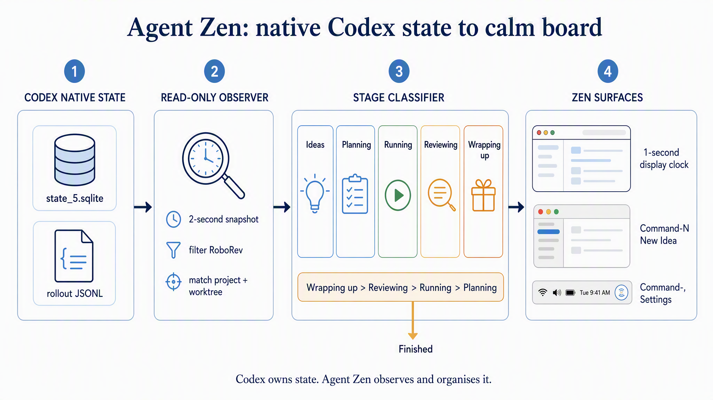

# Agent Zen FAQ

Agent Zen is a local, Codex-first control plane: Codex owns session state; Agent Zen reads it, groups it, and adds a separate human Ideas and Logbook layer.

_Conceptual visual generated from the verified contracts below. The code and tests remain authoritative for exact predicates._

## How does Agent Zen connect to Codex?

**Short answer:** The local bridge combines supported Codex App Server control for sessions it launches with read-only observation of all indexed Codex sessions. ACP and hooks are not required.

The observer reads thread metadata from `~/.codex/state_5.sqlite` and lifecycle, message, plan, and completion records from each thread's rollout JSONL. It never writes to those stores. Agent Zen-owned launches use a bundled `codex app-server --stdio` child; externally launched sessions remain visible but read-only.

### Sources

- [ADR-0002](../adr/0002-native-codex-connection.md) — accepted integration boundary and rejected alternatives.
- [Codex observer](../../server/codex/stateObserver.ts) — SQLite and rollout observation.
- [Bridge service](../../server/bridgeService.ts) — observation and App Server control composition.

_Created: 2026-08-06 · Updated: 2026-08-06 · Verified: 2026-08-06 · Scope/version: Codex CLI 0.146-era local stores_

## What puts a session in each Kanban stage?

**Short answer:** Placement is derived, read-only, and evaluated in this precedence order: Wrapping up, Reviewing, Running, Planning. Ideas are human-authored records without a Codex thread.

| Stage | Exact qualifying condition |
| --- | --- |
| Ideas | A human-created Agent Zen idea; no Codex session exists yet. |
| Planning | The current Codex turn is live and has no native plan steps. |
| Running | The current Codex turn is live and has one or more native plan steps. |
| Reviewing | The current live turn contains an explicit review command or skill marker, such as `$visual-review`, `/roborev-review`, or `$webapp-agent-demo`. The marker persists for that turn. |
| Wrapping up | The current live turn contains `$wrapup`, `/wrapup`, or leading `wrapup`. It overrides Reviewing and plan-derived placement. |
| Finished | The turn is ended and leaves the focus board. There is intentionally no Done column or approximate history counter. |

Each new `task_started` record resets the turn-specific review/wrap-up hint and current plan. A later ordinary human message does not erase an explicit marker from the same turn.

### Sources

- [Stage derivation](../../src/domain/stage.ts) — precedence and plan predicates.
- [Rollout parser](../../server/codex/rollout.ts) — current-turn lifecycle, plan, review, and wrap-up extraction.
- [Stage tests](../../server/codex/rollout.test.ts) — marker persistence and precedence.

_Created: 2026-08-06 · Updated: 2026-08-06 · Verified: 2026-08-06_

## Why did automated RoboRev sessions appear in Planning, and how are they hidden?

**Short answer:** They are ordinary live Codex execution threads with no plan, so the general classifier correctly called them Planning. Agent Zen now excludes the known generated RoboRev review-task title before classification.

The app-side exclusion is deliberately narrow: `source = exec` and a normalized title beginning `You are a code reviewer. Review the code changes shown below.` This avoids changing global RoboRev behaviour or hiding human review sessions. If RoboRev changes its generated title, the filter and fixture test must be updated.

### Sources

- [Observer query](../../server/codex/stateObserver.ts) — exact pre-classification exclusion.
- [Observer tests](../../server/codex/stateObserver.test.ts) — positive exclusion evidence.

_Created: 2026-08-06 · Updated: 2026-08-06 · Verified: 2026-08-06_

## How and how often does the board refresh?

**Short answer:** The UI requests a fresh snapshot every 2 seconds. A separate 1-second UI clock only updates elapsed-time labels.

Each snapshot re-reads the bounded SQLite thread index and examines indexed rollouts. Unchanged rollout files are reused by size and modification time. Changed files are tailed up to 1 MiB; for long active turns, the observer searches backwards for the latest lifecycle, plan, and stage-marker anchors so state does not disappear merely because it fell outside the tail window.

This is polling, not a hook. The maximum ordinary visible lag is therefore about two seconds plus local parsing time.

### Sources

- [HTTP bridge client](../../src/bridge/httpBridge.ts) — 2-second polling and request timeout.
- [Codex observer](../../server/codex/stateObserver.ts) — cache, bounded tail, and anchor recovery.
- [App state provider](../../src/state/store.tsx) — 1-second display clock.

_Created: 2026-08-06 · Updated: 2026-08-06 · Verified: 2026-08-06_

## Are worktrees discovered and linked to their main project?

**Short answer:** Yes. The bridge discovers Git checkouts under configured roots. A session first matches the deepest project directory containing its cwd; an external worktree then falls back to the normalized GitHub remote.

Registration controls which projects Agent Zen may launch into. Observation and identity matching use all discovered candidates, so an existing worktree can be labelled without registering every worktree as a separate project. The Kanban can group cards by project; that changes presentation only.

### Sources

- [Project discovery](../../server/projects.ts) — Git checkout, branch, and remote discovery.
- [Observer project resolution](../../server/codex/stateObserver.ts) — cwd-first and repository fallback matching.
- [Kanban grouping](../../src/components/KanbanView.tsx) — project sections inside each stage.

_Created: 2026-08-06 · Updated: 2026-08-06 · Verified: 2026-08-06_

## Is the Kanban editable?

**Short answer:** No. Session cards cannot be dragged between stages because that would create a second truth that can disagree with Codex.

Humans may capture ideas, register projects, add Logbook notes, choose filters and grouping, and control Agent Zen-owned sessions. Stage corrections belong in the observer or classifier rather than as per-card overrides.

### Sources

- [ADR-0005](../adr/0005-read-only-board-and-quiet-settings.md) — read-only board decision.
- [Kanban view](../../src/components/KanbanView.tsx) — presentation without mutation controls.

_Created: 2026-08-06 · Updated: 2026-08-06 · Verified: 2026-08-06_

## What does the focus limit actually enforce?

**Short answer:** When enabled, it refuses only a new root-session launch after every slot is occupied. It never kills, pauses, or moves existing work.

Planning and Running root sessions consume slots. Child agents share their parent's slot. Reviewing and Wrapping up release capacity. The limit defaults off, and concurrent launch requests are serialized so two requests cannot both claim the final slot.

### Sources

- [Focus policy](../../server/domain/focusPolicy.ts) — server-side launch decision.
- [Stage domain](../../src/domain/stage.ts) — active-slot counting rules.
- [Bridge service](../../server/bridgeService.ts) — serialized enforcement before launch.

_Created: 2026-08-06 · Updated: 2026-08-06 · Verified: 2026-08-06_

## Where do Ideas and Logbook notes live, and why were mock ideas visible?

**Short answer:** They live only in browser localStorage under `agent-zen.state.v1`. The visible mock ideas were mistakenly shipped as production defaults; production now starts empty and migrates known prototype records away.

The current persisted schema is version 2 even though the storage key retains its old name so existing data can be migrated. Migration removes only the exact prototype IDs; user-created ideas and notes are preserved. Registered projects, focus settings, and Agent Zen-owned thread identity instead live in `~/.agent-zen/settings.json`.

Clearing site data deletes local Ideas and Logbook notes. Cross-browser or cross-machine sync is not implemented.

### Sources

- [Local persistence](../../src/state/persistence.ts) — empty defaults, schema migration, and exact prototype IDs.
- [Persistence tests](../../src/domain/derivation.test.ts) — prototype removal and user-data preservation.
- [Settings store](../../server/settings.ts) — bridge-owned durable settings.

_Created: 2026-08-06 · Updated: 2026-08-06 · Verified: 2026-08-06 · Scope/version: local schema v2_

## Where did “113 finished sessions in history” come from?

**Short answer:** It was not a trustworthy history total. The observer loaded a bounded window of 120 recent threads; at that moment seven were live, so the UI displayed the remaining 113 as “history”.

That counter has been removed. The bridge now sends active sessions to the focus board and does not imply that a bounded recent-thread sample is a complete archive. A real history view would need explicit pagination and a clear retention contract.

### Sources

- [Bridge service](../../server/bridgeService.ts) — active-session projection.
- [App tests](../../src/app.test.tsx) — no synthetic history count.
- [Codex observer](../../server/codex/stateObserver.ts) — bounded recent-thread query.

_Created: 2026-08-06 · Updated: 2026-08-06 · Verified: 2026-08-06_

## How do dense columns and card detail work?

**Short answer:** Every stage header shows its visible count. Columns scroll independently, show a bottom “Scroll for more” affordance when overflow exists, and can display either full details or titles only.

Cards reveal repository, branch, worktree, model, effort, Codex version, and IDs after a 1.2-second hover delay. Keyboard focus reveals the same information immediately. Group by Project adds project sections inside every stage without duplicating the project label on each card.

### Sources

- [Kanban view](../../src/components/KanbanView.tsx) — counts, overflow detection, grouping, and detail mode.
- [Kanban styles](../../src/components/KanbanView.module.css) — fixed headers and scroll affordance.
- [Session card styles](../../src/components/SessionCard.module.css) — delayed hover and immediate focus disclosure.

_Created: 2026-08-06 · Updated: 2026-08-06 · Verified: 2026-08-06_

## Why does Command-N open a browser window, and what does the native app change?

**Short answer:** Browsers reserve Command-N before page JavaScript can reliably handle it, so the web app truthfully uses `C`. The native WKWebView shell owns real macOS menu commands for Command-N New Idea and Command-, Settings.

The shell also adds a menu-bar companion showing active and visible session counts, with Open Agent Zen, New Idea, Settings, and Quit actions. Its embedded bridge is served on its own loopback origin, and the UI automatically connects back to that origin. The shell explicitly locates user-local `codex` installs because Finder-launched apps do not inherit the login-shell PATH.

This is an environment/distribution blocker, not a JavaScript shortcut bug.

### Sources

- [Native shell](../../native/AgentZenApp.swift) — menus, WKWebView, bridge ownership, and menu-bar status.
- [macOS build](../../scripts/build-macos-app.sh) — app bundling and automatic Apple-identity selection.
- [Bridge URL tests](../../src/bridge/httpBridge.test.ts) — browser-development and packaged-origin routing.
- [ADR-0006](../adr/0006-browser-keyboard-and-accessibility.md) — keyboard and accessibility contract.

## How should the native app be distributed?

**Short answer:** First test an Apple-signed native build on the personal Mac, then ship a hardened and notarised Developer ID build. Treat the Mac App Store as a later distribution target.

`bun run build:macos` automatically prefers `Developer ID Application`, then `Apple Development`, and otherwise emits an explicitly warned ad-hoc build. It signs the compiled Bun bridge with the required JavaScriptCore JIT entitlements before signing and verifying the outer app. An Apple Developer account helps, but Xcode or the developer portal must create and install the certificate and private key on the build Mac.

The Mac App Store requires sandboxing. Agent Zen needs deliberate entitlements and user-granted access for local Codex stores, repositories, Git, and subprocess control, so that work should be designed and tested rather than added as a packaging afterthought.

### Sources

- [Native distribution ADR](../adr/0007-native-shell-and-distribution.md) — accepted distribution ladder and current blocker.
- [Apple certificates overview](https://developer.apple.com/help/account/certificates/certificates-overview/) — certificate types and management.
- [Apple notarisation guidance](https://developer.apple.com/documentation/security/notarizing-macos-software-before-distribution) — Developer ID notarisation requirement.

_Created: 2026-08-06 · Updated: 2026-08-06 · Verified: 2026-08-06_

## What does project onboarding do?

**Short answer:** It discovers local Git checkouts, lets the user select a small initial set, and stores only those explicit registrations for launch authorization.

Discovery shows repository identity, path, branch, and registration state. Registration is not needed merely to observe or label a session, but launching requires a registered project so the local bridge never accepts an arbitrary cwd from the browser.

### Sources

- [Project onboarding UI](../../src/components/ProjectOnboardingDialog.tsx) — selection flow.
- [Project discovery](../../server/projects.ts) — local Git metadata.
- [Security tests](../../server/security.test.ts) — loopback and launch-boundary checks.

_Created: 2026-08-06 · Updated: 2026-08-06 · Verified: 2026-08-06_

## Which earlier visuals are retained?

**Short answer:** The connection diagram, live-demo poster, and current stage/refresh diagram are stored beside this FAQ so they remain discoverable after the session dashboard disappears.

- [Codex connection architecture](2026-08-06-agent-zen-codex-connection.png)
- [Live Codex demo poster](2026-08-06-agent-zen-live-demo-poster.png)
- [Stage and refresh flow](2026-08-06-agent-zen-stage-refresh.png)
- [Browser QA evidence](../../qa/README.md)

The poster records the first live bridge demonstration; it is historical evidence, not the current UI specification.

### Sources

- [QA index](../../qa/README.md) — retained screenshots, video, and validation context.
- [Visual design exploration](../../explorations/2026-08-05-codex-zen-directions/README.md) — selected visual direction.

_Created: 2026-08-06 · Updated: 2026-08-06 · Verified: 2026-08-06_
